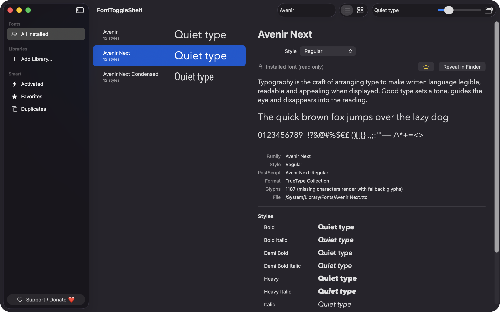
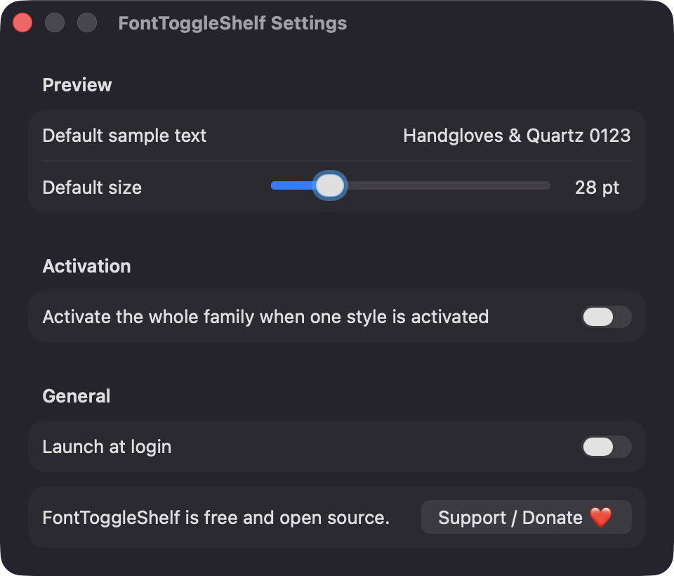
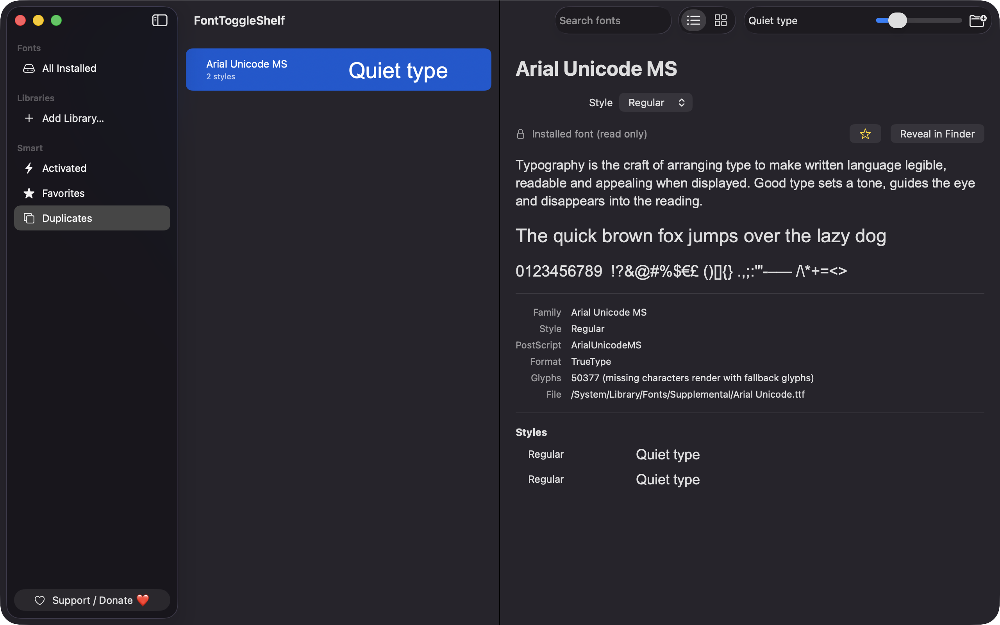

# FontToggleShelf

**🌐 Website:** [turhe123.github.io/font-toggle-shelf](https://turhe123.github.io/font-toggle-shelf/)

Browse font folders anywhere on disk, preview them with your own text, and switch fonts on or off without a subscription.


## Why

FontToggleShelf is a free, open-source, 100% native, backend-free alternative to paid utilities in the *Font Management* category. It was inspired by the workflow of tools such as RightFont ($59 /year): keep your fonts in any folder, preview them, and activate them only when you need them. Font Book covers installed fonts well, but has limited support for fonts that live in arbitrary folders or cloud drives, and that is the gap this app fills.

## Features

- **Font libraries from anywhere on disk.** Add any folder (Downloads, Dropbox, iCloud Drive, a project's assets) with the Add Library button or by dragging a folder onto the window or sidebar. Folders are scanned recursively for `.ttf`, `.otf`, `.ttc` and `.dfont` files (`woff`/`woff2` are ignored).
- **Metadata via CoreText.** Family, style, PostScript name, format and glyph count are read for every face, including each face inside a collection.
- **Live previews.** Every family is rendered in its own font with your sample text and a size slider (8–120 pt), in list or grid view. Fonts render even when they are not activated.
- **Activate / deactivate without copying files.** Toggle a whole family or a single style. Fonts are registered with CoreText by file URL, either for the current session (until logout) or, with the Persistent option, across restarts. Your font files are never moved or deleted.
- **Optional whole-family activation** when one style is activated (Settings).
- **Sidebar:** All Installed (read-only system and user fonts), each library, Activated (with a count of session-only fonts), Favorites, and Duplicates (PostScript names found in more than one file).
- **Search** by family, style or PostScript name.
- **Favorites**, stored by PostScript name.
- **Detail pane** with file path, format, glyph count, a multi-line sample paragraph and Reveal in Finder.
- **Conflict handling.** If a font with the same PostScript name is already active from another file, the app shows the error inline with a Reveal Other File button.
- **Corrupt or unsupported files** show a warning and the CoreText error instead of a preview.
- **Live folder watching** with a short debounce, plus a progress indicator in the sidebar while large folders scan. Results are cached in Application Support so the window opens quickly.
- **Stale folders.** If a library folder was moved or deleted, a Relocate button lets you pick it again. Libraries are remembered with security-scoped bookmarks.
- **Removing a library** deactivates its session fonts first.
- **Settings:** default sample text, default size, activate-whole-family, launch at login.
- **Keyboard shortcuts:** ⌘F find, ⌘O add library, ⌘R rescan, ⇧⌘A toggle activation, ⌘D toggle favorite.

## Screenshots

<p align="center"></p>

<p align="center"><em>Browse installed fonts with your own sample text, and open a family to see every style, its metadata, and the file it comes from.</em></p>

<p align="center"></p>

<p align="center"><em>Settings for the default sample text and preview size, whole-family activation, and launch at login.</em></p>

<p align="center"></p>

<p align="center"><em>The Duplicates view lists fonts whose PostScript name appears in more than one file.</em></p>

## Install

1. Download `FontToggleShelf-macOS.zip` from the [latest release](https://github.com/turhe123/font-toggle-shelf/releases/latest).
2. Unzip it and move `FontToggleShelf.app` to `/Applications`.
3. Because the app is open source and not notarized, clear the quarantine attribute:

   ```bash
   xattr -cr /Applications/FontToggleShelf.app
   ```

4. The first time, right-click the app and choose **Open**.

## Build from source

Requires macOS 14+ and Xcode with Swift 5.9 or later.

```bash
brew install xcodegen
xcodegen generate
xcodebuild -project FontToggleShelf.xcodeproj -scheme FontToggleShelf -configuration Release -derivedDataPath ./build build
```

The app is produced at `build/Build/Products/Release/FontToggleShelf.app`.

## Permissions

FontToggleShelf does not request Accessibility, Screen Recording, Microphone, Camera, Contacts or any other privacy permission. The code touches only:

- **Folders you choose.** Access to a library folder comes from your selection in the open panel or by dropping it, and is remembered as a security-scoped bookmark. macOS may ask for access to protected locations such as Documents, Desktop or iCloud Drive.
- **Font folders.** `/System/Library/Fonts`, `/Library/Fonts` and `~/Library/Fonts` are read (never modified) to list installed fonts.
- **Login Items (optional).** The "Launch at login" setting uses `SMAppService`; macOS may show it under System Settings › General › Login Items.
- **Application Support.** A scan cache is stored in `~/Library/Application Support/FontToggleShelf/`.

## Built with AI

FontToggleShelf was written by [Claude Code](https://claude.com/claude-code) inside an automated pipeline, from a plain-English spec. No code, binaries or assets from any commercial app were used; it is a clean-room reimplementation of a feature set, not a copy.

What that means in practice:

- The full source is in this repo under the MIT license. Read it before you run it.
- No network calls, no analytics, no third-party dependencies. Only Apple frameworks.
- Ad-hoc signed and not notarized, which is why Gatekeeper warns on first launch.
- It has had less human review than a hand-written app. Bug reports and pull requests are welcome.

## Support ❤️

FontToggleShelf is free. If it saves you time, you can support its development:

[Support Or (Leo) Davidai ❤️ on Ko-fi](https://ko-fi.com/leodavidai)

## License

MIT © Or Davidai Bachar

## More free Mac apps

Prefer something that runs in the browser? The same pipeline builds [free, private web tools](https://turhe123.github.io/web-tools/): PDF, image, developer, data and audio tools, nothing uploaded.
